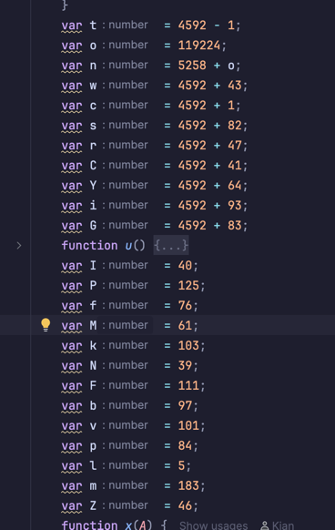
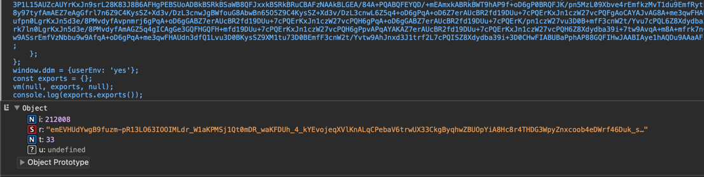
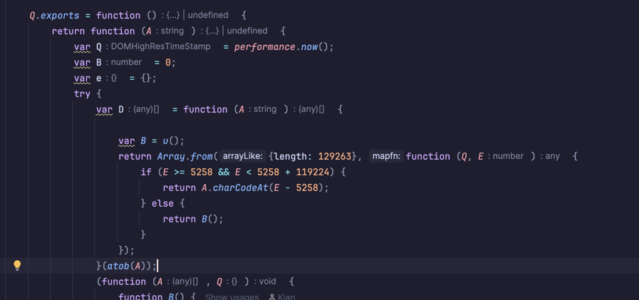
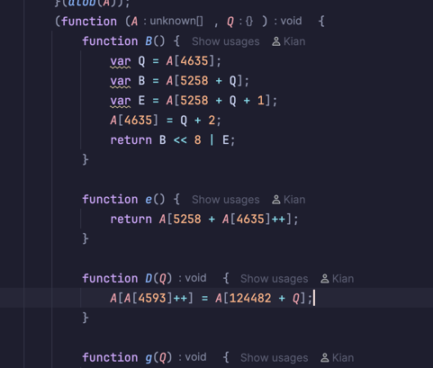
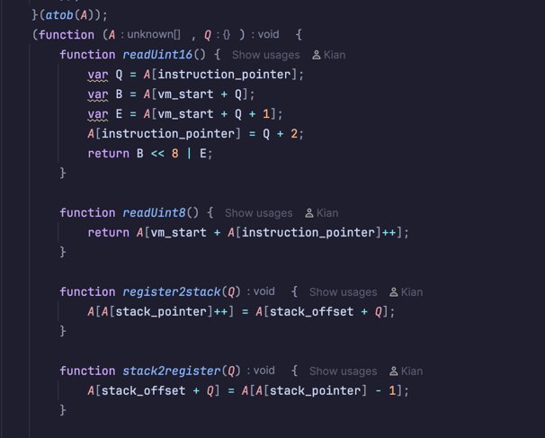
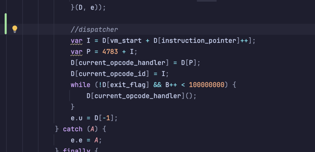
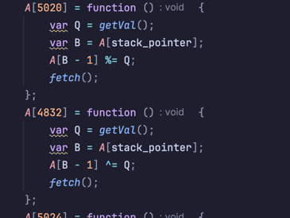

# DataDome VM Analysis & Deep Reverse Engineering

## Summary
This repository documents an end-to-end forensic analysis of DataDome's in-browser JavaScript virtual machine (VM) used in their interstitial / CAPTCHA challenge flow.

- **Part 1:** Initial deobfuscation, bytecode loading, and memory architecture.
- **Part 2 (Deep Research Extension):** Correction of the disassembler alignment bug (achieving **0 unknown opcodes** across 31,437 instructions), full identification of the 117 internal VM closures, extraction of the static 256-byte S-Box, byte-by-byte reversing of the telemetry payload, and a standalone clean-room runner with an offline payload decryptor.

---

## Part 1: Architecture & Deobfuscation

### Background
In early 2026, DataDome began shipping a custom VM-based component in their client-side anti-bot interstitial script.

### Deobfuscation
The VM code was extracted from the challenge script into `vm.js`. The initial obfuscation wraps literals and variables in repetitive evaluator expressions:



Evaluating and replacing these variables yields the deobfuscated implementation in [out.js](out.js).

### Initial Analysis
Running the deobfuscated code reveals the VM's expected output envelope: a JSON object with a Base64URL string `r`, instruction count `i`, and execution duration `t`:



### Bytecode Decoding



At the entry point of the export function, bytecode is unpacked:
1. The input string is base64 decoded.
2. An array of 129,263 elements is allocated.
3. Indices within the declared range are populated; out-of-range slots are filled with PRNG noise (`B()`).

### VM Architecture & Memory Model



The VM executes within a single unified array (`A`) that maps stack, registers, opcodes, and memory:

```js
var stack_pointer = 4593
var instruction_pointer = 4635
var frame_base_pointer = 4674
var last_result = 4633
var exit_flag = 4656
var current_opcode_handler = 4685
var current_opcode_id = 4675
var stack_offset = 124482
var vm_start = 5258
```

### Helper Functions



The initialization routines configure helpers for stack pop/push, register transfer, and typed immediate decoding.

### The Dispatcher Loop



The dispatcher fetches instructions sequentially from `A[vm_start + instruction_pointer]`, looks up the handler at `A[4783 + opcode]`, and calls it until `exit_flag` is set.

### Core Handlers



- **Opcode 4919 (`CLOSURE`):** Instantiates closures with captured parent activation frames.
- **Opcode 5003 (`CALL`):** Dispatches regular and constructor calls.
- **Opcode 4961 (`OBJECT`):** Constructs object literals from key/value stack pairs.

---

## Part 2: Inside the VM & Advanced Reverse Engineering

*This section continues the investigation beyond initial public notes, resolving previous disassembler blockers and uncovering the internal telemetry pipeline.*

### 1. The Disassembler Alignment Bug & Fix
Previous disassemblers produced 79 false `UNK_` opcodes due to an alignment error in opcode 136 (`CLOSURE`). The disassembler consumed two immediate bytes assuming they were a skip offset. 

In the actual bytecode, `CLOSURE` takes only `locals` and `captures`, immediately followed by an autonomous `JMP_FWD` (`0x4a`) instruction. Consuming those bytes corrupted the instruction stream.

**The Fix:**
[`disasm_improved.js`](disasm_improved.js) treats `CLOSURE` and `JMP_FWD` independently. The entire 119,224 bytes of bytecode now disassemble cleanly with **0 unknown opcodes** across all 31,437 instructions:

```assembly
0045bb:  88 0e 00                 CLOSURE locals=14, body=L_45c1
0045be:  4a 02 83                 JMP_FWD L_4844
L_45c1:
0045c1:  7c 00 04                 PUSH_FRAME 4
```

### 2. Environment Fingerprinting & Telemetry
The VM compiles 147 bytes of environmental telemetry into `reg[318]` before serialization:

- **Error Stack Trace Inspection:** Calls `new Error().stack` to detect function hooks, proxies, and automation debuggers.
- **CSS Box Model Verification:** Injects a hidden `div` with `box-sizing: content-box; width: 29px; padding-left: 17px;` and measures `clientWidth`. Headless engines lacking layout rendering return incorrect values.
- **High-Resolution Jitter:** Cross-checks `performance.now()`, `Date.now()`, and VM loop iteration counter `e.i`.
- **Context Integrity:** Verifies `window.ddm.userEnv`, `location.pathname`, and `navigator.webdriver`.

### 3. Cryptographic Serialization & S-Box Extraction
The 147-byte telemetry buffer (`reg[318]`) is encrypted using a static 256-byte S-Box embedded directly in the bytecode (`reg[23]`):

```text
[Telemetry Buffer: 147 bytes]
            │
            ▼ (XOR Cipher with S-Box from reg[23])
[Encrypted Data: 147 bytes]
            │
            ▼ (Append 8-byte tag from reg[19])
[155-byte Serialized Buffer]
            │
            ▼ (window.btoa)
[Base64 Encoding]
            │
            ▼ (.replace(/\+/g, "-").replace(/\//g, "_").replace(/=/g, ""))
[Final 'r' Token]
```

Because the S-Box is completely static, any `r` token can be decrypted offline without server interaction.

---

## Research Tooling Suite

This repository includes custom tools developed for analysis, devirtualization, and token generation:

### 1. [`disasm_improved.js`](disasm_improved.js)
Production disassembler generating fully labeled assembly with 0 UNKs.
```bash
node disasm_improved.js bytecode.bin > out_improved.txt
```

### 2. [`datadome_decryptor.py`](datadome_decryptor.py)
Offline Python decryptor that extracts the 147 raw telemetry bytes from any DataDome `r` token.
```bash
python3 datadome_decryptor.py "<token_r>"
# Output structured JSON:
python3 datadome_decryptor.py "<token_r>" --json
```

### 3. [`callgraph_extractor.py`](callgraph_extractor.py)
Extracts all 117 internal VM closures into a structured index ([`call_graph.json`](call_graph.json)) with parameter counts, captures, and referenced strings.
```bash
python3 callgraph_extractor.py
```

### 4. [`devirtualizer.js`](devirtualizer.js)
Decompiles the 117 VM closures from bytecode into readable JavaScript functions stored in [`devirtualized/`](devirtualized/).
```bash
node devirtualizer.js
```

### 5. [`standalone_runner.js`](standalone_runner.js)
Executes the VM in pure Node.js in ~60ms with sanitized `Error.stack` frames and authentic CSS Box-Model simulation.
```bash
node standalone_runner.js
# Or pipe directly to the decryptor:
node standalone_runner.js --json | jq -r .token_r | python3 datadome_decryptor.py
```

---

## Disclaimer

This project is for educational and security research purposes only. It is intended to study virtual machine architecture, static analysis methodologies, and client-side protection mechanisms.
